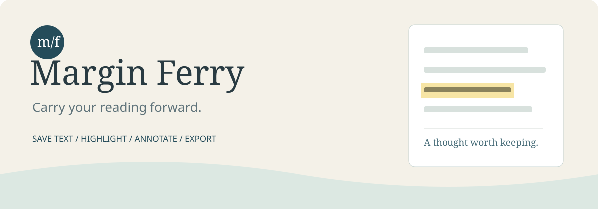
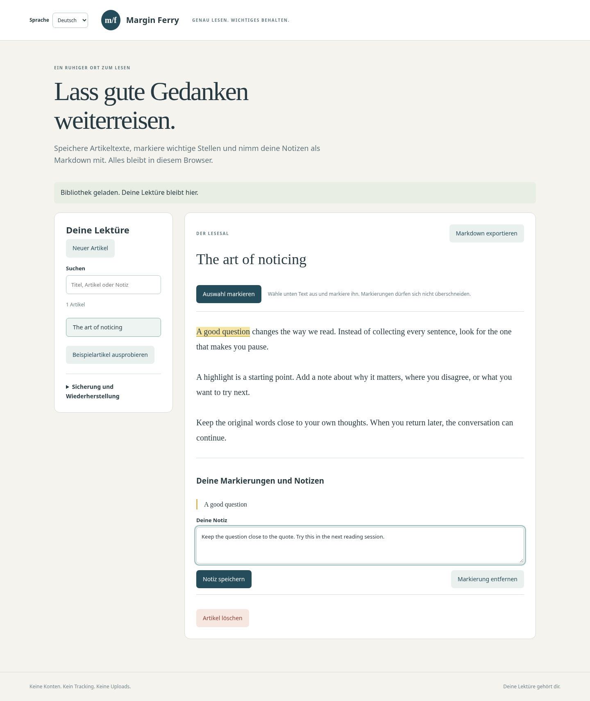

# Margin Ferry

**An open-source alternative to Readwise Reader’s article highlighting and Markdown export workflow.** Save pasted article text, highlight exact passages, attach notes, and take your reading with you. Browser-local storage. Six interface locales. MIT licensed.

**Status:** locally tested candidate. No public repository, hosted demo or release is claimed. This app does not fetch webpages, read PDFs, sync devices or summarize content.



## Try it

Extract the supplied ZIP, open a terminal in its `margin-ferry` folder, and run:

```sh
python3 -m http.server 5140 --bind 127.0.0.1
```

Open **http://127.0.0.1:5140** in a current desktop Chromium browser. Select **Try a sample article**, select a passage, then choose **Highlight selection**. Add a note and save it. **Export Markdown** downloads the article, quotes and saved notes.

There is no build step or runtime dependency installation. Keep the same host and port to use the same local library. Public static hosting requires HTTPS; no hosted deployment has been tested. File URLs are not a supported launch method because safe storage needs a secure browser context.

## A small, complete reading workflow

- Paste an article with its title and optional source URL. URLs are references; they are never fetched.
- Select text with a mouse or keyboard, highlight it, and save a note. Saved source text is fixed so annotations do not drift.
- Search article titles, full text and saved notes. Remove individual highlights or whole articles.
- Export readable Markdown and portable JSON backups. Merge or explicitly replace a validated backup. Recover corrupt storage only after exporting its original bytes.
- Switch among English, German, Spanish, Japanese, Simplified Chinese and Traditional Chinese without translating your content or losing note drafts.

Overlapping highlights are rejected. Up to 500 articles, 200,000 characters per article, 500 highlights per article, and 4 MB per saved library/backup. Clearing site data deletes the library. Markdown and JSON exports contain saved data; export regularly and save note drafts first.

## Readwise Reader comparison

[Readwise’s export documentation](https://docs.readwise.io/reader/docs/faqs/exporting) describes Markdown annotations and integrations with note-taking apps. Margin Ferry covers a smaller, local workflow:

| Workflow | Margin Ferry |
|---|---|
| Save something to read | Paste article text and an optional source URL |
| Highlight and annotate | Exact text selections and per-highlight notes |
| Take notes elsewhere | Download Markdown; manually move it into your notes folder |
| Back up and move libraries | Validated JSON export/import |
| URL scraping, PDFs, RSS, cloud sync, automatic note-app integration | Not included |

This is a workflow alternative, not a claim of Readwise feature parity or affiliation. [Scope, naming and distribution notes](docs/SCOPE.md).

## Development and checks

```sh
npm ci
npm test
npx playwright install chromium
npm run test:browser
```

Python 3 hosts the disposable localhost test fixture. `CHROMIUM_PATH` optionally selects an installed Chromium. Browser checks cover saving, selection highlights, notes, Markdown download, JSON restore, stale-tab protection, corrupt-data recovery, all six locales, mobile layout and zero external requests. GitHub CI is configured but has not run because this repository has not been published.

UI translations are bundled and unknown technical diagnostics fall back to English. Native browser controls follow the browser language. Independent native-speaker review and touch-selection testing remain pending. The screenshot uses a synthetic article, not scraped or customer data.
